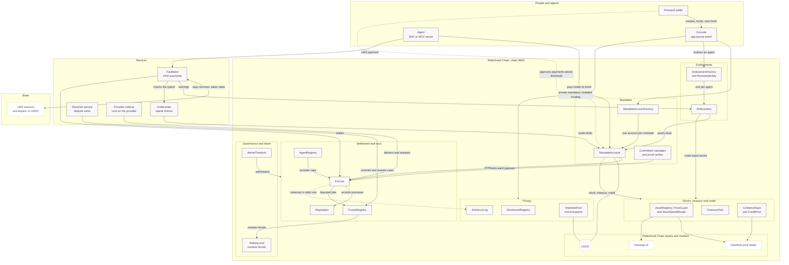

  

Bursar gives an AI agent money of its own and limits it cannot break. Endow an agent once: the
principal stays invested in listed US stocks on Robinhood Chain, anyone can add to it, and the agent
spends a yearly draw. That spending runs through a mandate, a contract that sets how much the agent
may pay per call, per day and per month, which providers it may pay, and the amount above which a
person has to approve. A payment outside those limits fails on chain, whatever any service in front
of it says.

The agent pays in USDG over [x402](https://www.x402.org), the HTTP payment standard. Each payment
waits in escrow until the job is delivered and can be disputed until then.

## Live today

- **[Endowments](https://app.bursar.world/endowments).** Endow any ERC-8004 agent on Robinhood Chain,
  Base or Ethereum. An agent that sells over x402 on Base has what it earns paid into its endowment.
- **[Console](https://app.bursar.world).** Create and fund a mandate, set its limits, approve larger
  payments, see what your agents spent, and dispute a job that came back wrong.
- **Contracts on Robinhood Chain mainnet** (chain 4663), settling in USDG. Every address is listed
  in the [bursar repository](https://github.com/bursar-world/bursar#deployed-contracts).
- **Payments beyond Robinhood Chain.** A mandate pays x402 services on Base in USDC, and Bursar
  supports the [Machine Payments Protocol](https://mpp.dev) from Stripe and Tempo.
- **Agents and assistants.** An MCP server, hosted at mcp.bursar.world for ChatGPT, Claude and Gemini,
  packages for Coinbase AgentKit, LangChain, the OpenAI Agents SDK and the Vercel AI SDK, and a skill
  for OpenClaw.
- **Providers.** A Cloudflare Worker charges agents with one import. A route that also takes USDC on
  Base through Coinbase is indexed in the Bazaar behind [Agentic.Market](https://agentic.market).
- **Stocks and treasury.** A mandate can buy listed stock tokens at a price checked against
  Chainlink feeds, keep idle USDG in a short-term Treasury fund (SGOV), and draw USDG credit
  against stock tokens pledged as collateral.
- **Private mandates.** A mandate's terms can stay off the public record, with a zero-knowledge
  proof that each payment fits them. Funding and payments can go through a shielded USDG pool,
  and you choose who may read your records.
- **[Stats](https://app.bursar.world/stats).** What agents have paid through Bursar, read live from
  the contracts.
- **$BURSAR.** Bursar's token on Robinhood Chain,
  [`0xe4d2422ed4d203a0f1ec2043a4db1eda426fca18`](https://robinhoodchain.blockscout.com/token/0xe4d2422ed4d203a0f1ec2043a4db1eda426fca18). It trades on
  [Pons](https://www.ponsfamily.com/launchpad/0xe4d2422ed4d203a0f1ec2043a4db1eda426fca18).
- **[Documentation](https://app.bursar.world/docs)** and the product site at
  [bursar.world](https://bursar.world).

The contracts hold real funds and have not had an external audit. They run with low limits: a
provider with no history can be paid at most 25 USDG per job, rising with its record to at most
250 USDG. Size what you fund accordingly.

## Repositories

| Repository | What it holds |
|---|---|
| [bursar](https://github.com/bursar-world/bursar) | The contracts, the TypeScript SDK and MCP server, the payment services and the console. MIT licensed. |
| [landing](https://github.com/bursar-world/landing) | The website at [bursar.world](https://bursar.world). |
| [.github](https://github.com/bursar-world/.github) | This page and the default security, contribution and conduct policies for every repository. |

## How it fits together

A patron endows an agent in the console, and the endowment pays the agent a yearly draw into its
mandate. A principal sets a mandate's limits, and the factory deploys one account for them. An
agent pays through that account, directly or as an x402 payment the facilitator checks and
settles. Each payment is locked in escrow until the provider's sidecar delivers the work and
releases it. A disputed job goes to bonded resolvers, who vote on chain. A static copy of this
diagram is in [architecture.svg](./assets/architecture.svg).

## Get started

**Patrons.** Open [the endowments page](https://app.bursar.world/endowments), find an agent by its
ERC-8004 id and fund it. Anyone can add to an endowment after that.

**Principals.** Open [app.bursar.world](https://app.bursar.world), connect a wallet on Robinhood
Chain, create a mandate and fund it with USDG. Give your agent a key of its own and name its
address as the mandate's agent. Start with a small balance.

**Agent developers.** Pay from code with [`@bursar/sdk`](https://github.com/bursar-world/bursar/tree/main/packages/sdk),
or give an agent the same abilities through [`@bursar/mcp`](https://github.com/bursar-world/bursar/tree/main/packages/mcp).
Both are on npm under [`@bursar`](https://www.npmjs.com/org/bursar), with adapters for the common
agent frameworks.

**Providers.** `npm create @bursar/provider` scaffolds a Cloudflare Worker that charges agents over
x402. The [provider sidecar](https://github.com/bursar-world/bursar/tree/main/services/sidecar) takes
on jobs from escrow for any other stack. What you can be paid per job grows with your settlement
record.

## Security

Please report vulnerabilities privately to [security@bursar.world](mailto:security@bursar.world)
or through GitHub private vulnerability reporting on the affected repository. The
[security policy](https://github.com/bursar-world/.github/blob/main/SECURITY.md) explains what
to include and what happens next.

## Contact

[bursar.world](https://bursar.world) · [X @UseBursar](https://x.com/UseBursar) ·
[hello@bursar.world](mailto:hello@bursar.world) · [security@bursar.world](mailto:security@bursar.world)
